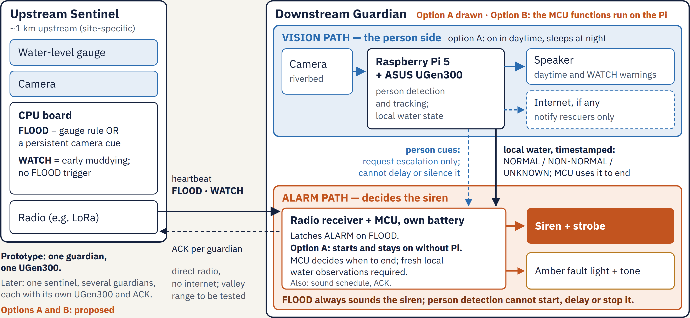

# FloodHerald (暴洪先聲)

Offline flash-flood warning for mountain-stream swimming spots.

An **upstream sentinel** watches the river and radios a **downstream guardian**
at the swimming spot. On a flood alert the guardian latches a siren on site,
with no internet in the alarm path. An **ASUS UGen300** (Hailo-10H) at the
guardian runs on-device person detection to give spoken warnings to people at
the water. Person detection never starts, delays or stops the siren.

Entry for the [ASUS UGen AI League](https://contest.bhuntr.com/tw/39jg9vimiynrhlksze/home/),
Battlefield Lightning track (UGen300), onsite group.

- Demo video: coming soon
- Status: **Stage I — laptop simulation.** The two-node hardware is a
  proposed design and is not built yet.
- Verified so far: 30 automated functional tests of the alarm rules, prompts,
  clip loading and audio alignment. No UGen300 throughput, end-to-end
  latency, power consumption or real-stream detection accuracy has been
  measured yet; those are Stage II work.



## What is in this repository

| Path | Contents |
|---|---|
| [`sim/`](sim/) | Laptop simulation: YOLOv8 person detection on video, injected water states, the downstream alarm rules as a state machine, program-triggered siren and spoken prompts. Tests, scenarios, audio assets. See [`sim/README.md`](sim/README.md). |
| [`video/`](video/) | How the demo video was made: MiniMax H3 prompts and ComfyUI workflows for each generated clip, title cards (HTML) and the assembly script. The generated clips themselves are not included. |
| [`assets/figures/`](assets/figures/) | Architecture figure (SVG and PNG). |

## The alarm rules shown in the simulation

- An upstream FLOOD latches the alarm whether or not anyone is detected.
- The alarm ends only when upstream and the local water have both been
  continuously and freshly normal for a set time, **and** a site-specific
  travel-time margin has passed since the last FLOOD. Zero detections never
  end it.
- In a no-swimming zone, a person detected in the zone gets a spoken warning
  even without a flood. In a recreation area there is no routine warning;
  during an alarm, people still in the river area get an evacuation call.

The simulation covers a selected subset of these rules; the scope, the
assumptions and what is not simulated are listed in [`sim/README.md`](sim/README.md).

## Quick start (simulation)

Requirements: [uv](https://docs.astral.sh/uv/), Python 3.12+, and `ffmpeg`
(with libx264) and `ffprobe` on PATH — the tests call ffmpeg too.

```bash
cd sim
uv sync
uv run pytest -q
```

The tests need no video clips and no model weights. Rendering a scenario
needs your own person clip, and the first run downloads the YOLOv8 weights;
see [`sim/README.md`](sim/README.md). Rebuilding the demo video additionally
needs Google Chrome (title cards, fonts loaded from Google Fonts) and ffmpeg
with subtitle support.

## Hardware plan (Stage II)

- Downstream guardian: Raspberry Pi 5 + ASUS UGen300 + camera + speaker,
  siren and strobe; two build options (A: separate MCU with its own battery
  holds the alarm; B: the Pi holds it, with a hardware watchdog).
- Upstream sentinel: water-level gauge, camera, CPU board and radio (e.g. LoRa).
- Stage I runs YOLOv8s on a laptop CPU. In Stage II the detector moves to the
  UGen300; the [Hailo Model Zoo](https://github.com/hailo-ai/hailo_model_zoo)
  provides compiled YOLOv8 models for the Hailo-10H.

## AI-generated content

- Video footage: generated locally with MiniMax H3; labelled on screen.
- Chinese spoken prompts: Google Gemini TTS. English narration: Kokoro-82M
  (Apache-2.0).
- Water states in the simulation are injected, not detected; timings are
  demo values, not field thresholds.

Details and licenses: [`sim/THIRD_PARTY_NOTICES.md`](sim/THIRD_PARTY_NOTICES.md).

## Sources

- "Ten seconds or less" once a wall of water appears: Taiwan fire and
  lifesaving guidance — Taipei Lifesaving Association (2025),
  [5 to 10 seconds](https://www.tlsa.org.tw/post/%E7%9C%8B%E5%88%B0-%E9%BD%8A%E9%A0%AD%E6%B0%B4-%E4%BD%A0%E9%82%84%E6%9C%89%E5%A4%9A%E5%B0%91%E6%99%82%E9%96%93%E5%8F%AF%E4%BB%A5%E5%BE%80%E9%AB%98%E8%99%95%E9%80%83%EF%BC%9F);
  New Taipei City Fire Department video (2017),
  [under 10 seconds](https://www.youtube.com/watch?v=J2UVlqgRhgo). The video
  cites this as "proposal Appendix B19".
- Hailo-10H compiled models:
  [Hailo Model Zoo, Hailo-10H object detection](https://github.com/hailo-ai/hailo_model_zoo/blob/master/docs/public_models/HAILO10H/HAILO10H_object_detection.rst).

## License

AGPL-3.0 (see [`LICENSE`](LICENSE)), because the simulation uses Ultralytics
YOLOv8. Third-party components and generated assets keep their own terms, listed in
[`sim/THIRD_PARTY_NOTICES.md`](sim/THIRD_PARTY_NOTICES.md).
